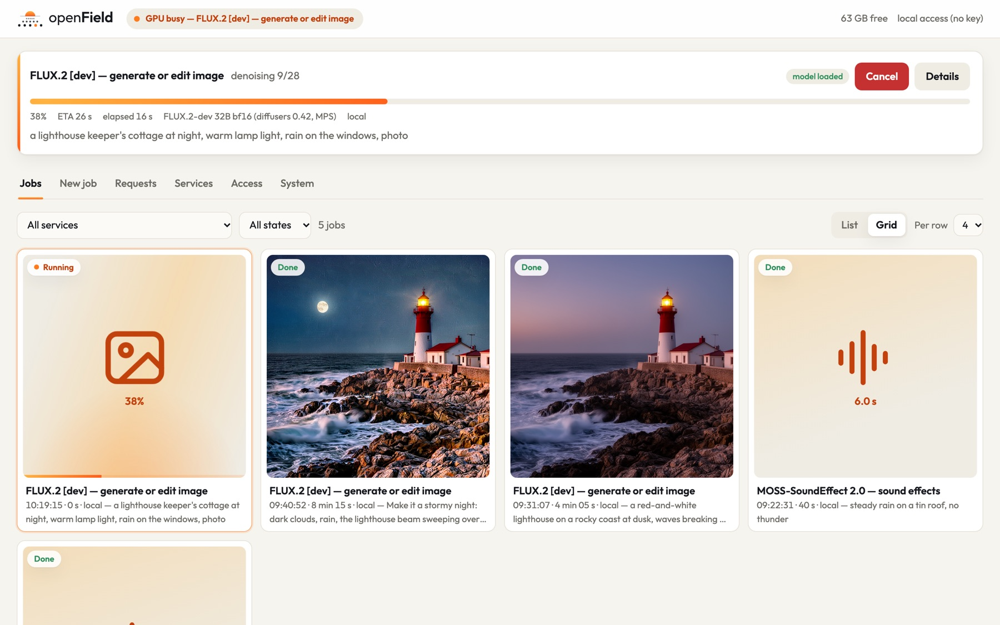

<p align="center"></p>

<p align="center"><b>Local AI services, one open field.</b><br>
Image generation and editing (Qwen Image, FLUX.2), video with sound, sound effects, video post-processing and local LLMs behind one daemon,<br>
with GPU resource control, a web UI, a REST API and an MCP server.</p>

<p align="center">
  <a href="https://github.com/jpbraga/open_field/actions/workflows/tests.yml"></a>
  <a href="https://github.com/jpbraga/open_field/releases"></a>
  
  <a href="https://modelcontextprotocol.io"></a>
  <a href="LICENSE"></a>
</p>

<p align="center"><a href="https://jpbraga.github.io/open_field/"><b>Website</b></a> ·
<a href="#install">Install</a> · <a href="#connect-an-ai-agent">Connect an agent</a> ·
<a href="#adding-a-service">Add a service</a> · <a href="CHANGELOG.md">Changelog</a></p>

<p align="center">
  <picture>
    <source srcset="docs/assets/screenshots/jobs-grid-dark.jpg" media="(prefers-color-scheme: dark)">
    
  </picture>
</p>

---

openField puts a machine's AI services behind one port (it was built on a 128 GB M5 Max). It decides how many
jobs the GPU runs at once and admits a new job only when there is a free slot **and** enough memory for its
model. Everything shows up in a web UI, and agents on other computers use the REST API or MCP.

- Web UI: `http://<host>:8765/` (no key on the machine itself; a key from other machines).
- REST API: `http://<host>:8765/api/v1/...` (interactive docs at `/api/docs`).
- MCP (streamable HTTP): `http://<host>:8765/mcp`.
- Skill for consumer agents: generated by the daemon at `/api/v1/skill` from the configured services
  (example: [`skills/openfield/SKILL.md`](skills/openfield/SKILL.md)).
- Brand: [`assets/brand/BRAND.md`](assets/brand/BRAND.md).

**Contents:** [Install](#install) · [Connect an AI agent](#connect-an-ai-agent) · [Access](#access) ·
[Large files](#large-files) · [How it works](#how-it-works) · [Commands](#commands) ·
[Adding a service](#adding-a-service) · [API](#api) · [Tests](#tests) · [License](#license)

## Install

macOS and Linux:

```sh
curl -fsSL https://raw.githubusercontent.com/jpbraga/open_field/main/install.sh | sh
```

Windows (PowerShell):

```powershell
irm https://raw.githubusercontent.com/jpbraga/open_field/main/install.ps1 | iex
```

Windows (cmd):

```bat
curl -fsSL https://raw.githubusercontent.com/jpbraga/open_field/main/install.cmd -o "%TEMP%\openfield-install.cmd" && "%TEMP%\openfield-install.cmd"
```

The installer:

1. installs [uv](https://docs.astral.sh/uv/), which takes care of Python;
2. downloads openField to `~/.openfield` (Windows: `%LOCALAPPDATA%\openfield\app`) and installs its dependencies;
3. puts the `openfield` command on the PATH;
4. creates the config in `~/.config/openfield` (Windows: `%APPDATA%\openfield`);
5. starts the daemon at login: launchd on macOS, systemd `--user` on Linux, Task Scheduler on Windows.

Running the installer again updates the installation.

Options (flags after `sh -s -- ...`, or environment variables, also on Windows):

| Flag | Variable | |
|---|---|---|
| `--with-tools` | `OPENFIELD_WITH_TOOLS=1` | Also download Real-ESRGAN and RIFE for the video services |
| `--port N` | `OPENFIELD_PORT` | Daemon port (default 8765) |
| `--dir DIR` | `OPENFIELD_DIR` | Where to install |
| `--ref REF` | `OPENFIELD_REF` | Branch or tag (default `main`) |
| `--no-service` | `OPENFIELD_NO_SERVICE=1` | Do not start at login |

Example: `curl -fsSL https://raw.githubusercontent.com/jpbraga/open_field/main/install.sh | sh -s -- --with-tools`.
The generative image and video services use macOS / Apple Silicon tools (mflux, Unsloth Studio's
stable-diffusion.cpp); on other machines they show as unavailable until those tools exist. The media services
need `ffmpeg`.

### Connect an AI agent

Open `http://localhost:8765/` once the daemon is running. On the same machine, Claude Code connects without a key:

```sh
claude mcp add --transport http openfield http://localhost:8765/mcp
```

From another computer, create a key in the web UI's **Access** tab: it shows the exact `claude mcp add` command
with the key's header, the `mcpServers` JSON for `.mcp.json`, Cursor and other clients, and the skill to install
(see [Access](#access)).

### Access

- **On this machine** (`http://localhost:8765/`): no key, full access. The web UI opens directly, and the API,
  proxies and MCP accept calls without a token. A page from another site open in the browser does not get this
  access: openField checks the request's `Host` and `Origin`.
- **From other machines** (`http://<ip>:8765/`): with a key, in `X-Token` (or `Authorization: Bearer`) or in the
  web UI's sign-in.

Keys live in the web UI's **Access** tab (or `openfield key`). Each key has a name and a role:

| Role | Can |
|---|---|
| Agent | REST API, MCP, proxies and jobs |
| Admin | Also create, disable and revoke keys, add and edit services, and change system settings (slots, reload) |

A key is shown once, when it is created: openField keeps only its hash (`{data_dir}/keys.json`, mode 0600). The
tab shows when each key was last used, and disabling or revoking a key also ends the web sessions opened with
it. oMLX's keys work too when oMLX is installed: its main key as an admin, its sub-keys as agents; they are
managed in oMLX.

**Connecting an agent.** When you create a key (or click **Connect** on an existing one), openField shows what to
give the consumer, with a copy button on each block:

- **MCP:** the `claude mcp add` command and the `mcpServers` JSON (`.mcp.json`, Cursor and other clients);
- **REST API:** the `OPENFIELD_URL` and `OPENFIELD_KEY` variables, a `curl` test, the OpenAPI schema and each
  proxy's OpenAI-compatible base URL;
- **Skill:** an Agent Skills `SKILL.md` generated from the configured services (parameters, API flow, what to do
  with 409 and 503), the command that installs it in Claude Code or Pi, and a text to paste into any agent's
  chat. The skill reads the key from the `OPENFIELD_KEY` variable and never stores it in the file.

The same `SKILL.md` comes from `GET /api/v1/skill` (with a key) and from `openfield skill`.

### Large files

Inputs and outputs of any size travel over plain HTTP, never inside a JSON body or a tool call, and the URLs carry
their own signature, so `curl` needs no key or environment variable (handy when an agent has openField's key only
in its MCP config):

1. `POST /api/v1/uploads` with `{"filename": "clip.mp4"}` (optionally `"size"` and `"sha256"`, checked at the end)
   returns an upload id and an `upload_url` with a token for that upload only.
2. `curl -fsS -T clip.mp4 "<upload_url>"` sends the file; the bytes stream to disk. If the transfer breaks, `GET` the
   URL for its `received` bytes and continue with `curl -C <received> -T clip.mp4 "<upload_url>"` (a
   `Content-Range` PUT). Small files can also go in one multipart `POST /api/v1/uploads` with a `file` field.
3. Submit the job with `"uploads": {"video": "<upload id>"}` in place of the file, with any accepted key. The job
   gets a hard link, not a copy, and the upload stays usable for `uploads.ttl_hours` (48 h by default) after its
   last use: after a 409, submit again without re-uploading, or run several jobs on one upload.

A job's `output_urls` are signed download links, valid `links_hours` (24 h by default; get the job again for fresh
ones). Outputs carry their SHA-256 in `outputs[]`, and downloads accept `Range` requests, so
`curl -fL -C - -o out.mp4 "<url>"` resumes a broken download. Over MCP, `create_upload` returns the URL and the exact
`curl` command for the agent to run from its shell, `submit_job` takes `uploads`, and `get_output` returns large
files as a signed URL with the checksum (only small images come back inline). On Windows PowerShell, use
`curl.exe`. The web UI's New job form uploads the same way, with a progress bar. Link tokens are kept out of the
access log.

## How it works

| Part | Where | What it does |
|---|---|---|
| Config | `config/daemon.yaml`, `config/services/*.yaml` | Port, resources, retention; one file per service |
| Adapters | `src/openfield/adapters/` | `shell`, `http_job`, `http_proxy`, `builtin` |
| Execution | `jobs.py`, `resources.py`, `runner.py` | Admission, slots, processes, progress, cancellation |
| Data | `~/.local/share/openfield/` | `openfield.db` (SQLite) and `jobs/<id>/` (inputs and outputs) |
| Web UI | `src/openfield/web/` | Plain HTML/JS, no build step, served by the daemon |

### Slots and resource checks

Each service declares the resources it uses (`resources: [gpu]`). A resource has **slots**: how many jobs may use
it at once. The number is a system setting, from 1 to `max_slots`, chosen in the web UI's **System** tab (or
`PUT /api/v1/settings`); the default comes from `daemon.yaml` and is 1.

A new job starts only if:

1. **a slot is free** on the resource. GPU tools running outside the daemon (`mflux-generate*`, `sd-cli`...) take
   a slot each;
2. **free memory covers its model:** free memory now, minus what jobs still loading their model will take, must
   exceed the service's `memory_gb` plus `memory_margin_gb`;
3. there is disk space.

The policy is `reject`: nothing is queued. Without a free slot, or without memory while other jobs run, the
answer is **409** with what is running and the ETA in `Retry-After`. If the job would not fit even with the GPU
idle, the answer is **503**. `shared` services (the LLM proxy) take one slot together, up to `max_concurrency`
calls.

Jobs running at once split the GPU, so each one is slower. It pays off for light jobs (an upscale next to an
image), not for two videos.

### Models

Each job runs its model in its own process: it loads at the start and is released when the process ends. The
web UI and the API show the model state (`loading`, `loaded`, `released`).

### Restarts and retention

A job interrupted by a daemon restart ends as `error` ("interrupted"). A failed or cancelled job can be run
again from the web UI (**Retry**) or with `POST /api/v1/jobs/{id}/retry`: a new job with the same parameters,
seed and input files, while the old one stays in the history. Files of finished jobs are kept for 7 days and
records for 90 (see `retention`); a job whose input files were removed can no longer be retried.

## Commands

```sh
openfield check                      # validate the config and show which services are available
openfield serve                      # in the foreground (port from daemon.yaml); --port N for another
openfield service install            # start at login (launchd / systemd --user / Task Scheduler)
openfield service status             # or uninstall
openfield key                        # list the keys (name, role, source, last use)
openfield key --new <name>           # create an agent key (--role admin for an admin key)
openfield key --revoke <id|name>     # revoke a key
openfield skill [-o SKILL.md]        # the skill for consumer agents (--url changes its address)
openfield install-tools              # Real-ESRGAN v0.2.5.0 and RIFE 20221029 (rife-v4.6) for this platform
openfield init                       # recreate the user config from the defaults (--force)
```

Logs go to `~/.local/share/openfield/daemon.log`. In a development checkout: `uv sync` and
`.venv/bin/openfield ...`; without a user config it uses the repository's own `config/` (`OPENFIELD_CONFIG`
picks another). The Real-ESRGAN and RIFE binaries live in `tools/`, outside git.

### Sound effects

`moss-sfx` (MOSS-SoundEffect v2.0, Apache-2.0: 48 kHz mono, up to 30 s, about 40 s per sound) and
`stable-audio-sfx` (Stable Audio 3.0 Small SFX, Stability AI Community License + Gemma terms: 44.1 kHz stereo,
up to 120 s, about a second per sound) turn a text prompt into WAV files for games and video: up to 4 variations per
job (take N uses seed + N - 1), silence trimming, seamless loops and peak normalisation
([`scripts/sound/generate_sfx.py`](scripts/sound/generate_sfx.py)). Both run on MLX, so they need an Apple
Silicon Mac. `sh scripts/sound/setup.sh` creates their environment in `tools/sound/.venv` and downloads the
weights into the Hugging Face cache (`--no-moss` skips MOSS and its MLX port).

### FLUX.2 [dev]

`flux2-image` runs FLUX.2 [dev] (32B, bf16) with diffusers on PyTorch's Metal backend: text to image up to 4 MP,
or editing and multi-reference composition from up to 10 reference images, with an optional prompt rewrite
by the text encoder (`enhance_prompt`). The text encoder (~48 GB) and the transformer (~64 GB) do not fit
together comfortably in 128 GB, so a job runs them as two processes, one after the other
([`scripts/flux2/flux2.py`](scripts/flux2/flux2.py)). Prompt embeddings are cached in
`~/.cache/openfield/flux2-embeds` (the newest 64, about 15 MB each), so a repeated prompt skips the encoder.
`sh scripts/flux2/setup.sh` creates the environment in `tools/flux2/.venv` and downloads the model (~105 GB);
the model is gated: accept its license on Hugging Face and log in with `hf auth login` first. The weights are
under the FLUX [dev] Non-Commercial License.

## Adding a service

In the web UI, **Services → New service** (admin keys or localhost):

- **API proxy (form):** a name, the upstream URL and how to authenticate there. This is the quick way to put an
  API that already runs (LM Studio, Ollama, Unsloth Studio, any OpenAI-compatible server) behind openField's
  keys, GPU slots and request log.
- **YAML templates:** a command-line service (`shell`), an asynchronous API (`http_job`) or a proxy, ready to
  edit, with validation as you type.
- **Copy an existing service**, or **Edit / Duplicate / Delete** on any service card. Proxies have a **Test
  connection** button.

Saving validates the file exactly like a reload, writes `config/services/<id>.yaml` and reloads the services; no
restart is needed. Services that run commands (`shell`, `builtin`) and services that use the daemon's secrets
can only be created, changed or removed from the openField machine itself (localhost), so a remote admin key
cannot run commands on it or send its secrets elsewhere.

You can also write the file by hand and click **Reload services** (or `POST /api/v1/admin/reload`);
`openfield check` shows config errors.

Common fields:

```yaml
id: my-service                # letters, digits, - and _
name: Name in the web UI
description: What it does, for people and agents
category: image               # image, video, video-post, llm, utility...
kind: shell                   # shell | http_job | http_proxy | builtin
resources: [gpu]              # slots the service takes ([] = runs even when the GPU is full)
lock: exclusive               # or shared (with max_concurrency)
model: Model name (shown in the status)
requires: [~/path/to/binary]  # globs; the service is unavailable when one is missing
memory_gb: "40 + 4*steps/10"  # expression over the params; used for admission
estimate_s: "30 + 2*steps"    # for the ETA before the first progress report
params:
  prompt: {type: string, required: true, max_length: 4000, description: ...}
  steps: {type: int, default: 30, min: 1, max: 100}
  seed: {type: int, default: random}        # "random" draws a seed
  size: {type: enum, values: [512, 1024], default: 1024}
  refs: {type: files, max_files: 4, accept: [image], max_mb: 40}   # file / files arrive as multipart
  extra: {type: json}                       # a list or an object
derive:                       # computed params (may override or add names)
  steps: "steps if steps else 30"
validate:                     # rules with an error message
  - {expr: "size*size <= 1048576", message: at most 1 MP}
agent_notes:                  # tips for agents, included in the generated skill
  - Keep the returned seed to regenerate the same image.
```

**Expressions** (`memory_gb`, `estimate_s`, `derive`, `validate`, `when`) are restricted Python: arithmetic,
comparisons, `and/or/not`, `x if c else y`, lists, `r["field"]`/`r.field` on dicts and the functions `min`,
`max`, `round`, `int`, `float`, `len`, `ceil`, `floor`, `sqrt`, `abs`, `snap_up(value, start, step, max)`.
**Templates** replace `{name}` with the value; `{work}` is the job's folder.

### `shell`: commands

```yaml
kind: shell
env: {HF_HUB_OFFLINE: "1"}
steps:
  - name: generate
    stage: loading the model         # text shown while it runs
    holds_model: true                # this process holds the model (loading -> loaded -> released)
    weight: "steps"                  # the step's weight in the overall progress (expression)
    when: "refs"                     # optional: runs only when the expression is true
    command: [~/bin/tool, --prompt, "{prompt}", --steps, "{steps}", --refs, "{refs}", --out, "{work}/out.png"]
    optional_args:
      - {when: "seed is not None", args: [--seed, "{seed}"]}
    progress:
      kind: regex                    # regex | ffmpeg | files | none
      regex: '(?P<done>\d+)/(?P<total>\d+) \['
      total_equals: steps            # ignore bars with another total (e.g. weight loading)
      start_after: 'sampling start'  # optional
      label: "step {done}/{total}"
      scale_from: 0.05
      scale_to: 0.95
      phases: [{regex: 'decoding', progress: 0.96, label: decoding}]
outputs:
  - {name: image, path: "{work}/out.png", media_type: image/png}
```

A `{param}` alone in an argument goes in as is (a list becomes several arguments). Paths in the YAML itself that
start with `~` or `/` and contain `*` resolve to the newest matching file (e.g.
`~/.unsloth/stable-diffusion.cpp/sd-*/sd-cli`); user values are never expanded.

### `http_proxy`: forwarding an API

```yaml
kind: http_proxy
resources: [gpu]
lock: shared
max_concurrency: 8
proxy:
  upstream: http://127.0.0.1:8010
  upstream_auth: headers         # passthrough | headers | none
  headers: {Authorization: "Bearer {secret.omlx_api_key}"}     # the service's own key, read at use time
  client_base: v1                # what clients add to /proxy/<id>/ for their base URL
```

Clients call `/proxy/<id>/<path>`. With `headers`, openField checks the caller's key and sends the service its
own key; with `passthrough`, it forwards the caller's key. Streaming (SSE) passes straight through, and every
call, accepted or refused, is logged in the Requests tab.

### `http_job`: an asynchronous API (submit, follow, download)

```yaml
kind: http_job
http:
  submit: {method: POST, url: "http://127.0.0.1:9000/generate", headers: {Authorization: "Bearer {secret.my_key}"},
           json: {prompt: "{prompt}", image: "{b64.ref}"}}
  poll: {url: "http://127.0.0.1:9000/jobs/{submit.id}", interval_s: 2, done: "r.status == 'done'",
         error: "r.error", progress: "r.progress", stage: "r.phase"}
  fetch: [{name: image, url: "http://127.0.0.1:9000/files/{r.file_id}", media_type: image/png, filename: out.png}]
  cancel: {method: POST, url: "http://127.0.0.1:9000/jobs/{submit.id}/cancel"}
```

`submit` and `r` are the JSON responses; `b64.<param>` is an uploaded file as a data URL; `secret.<name>` comes
from `secrets` in `daemon.yaml` (read at use time, never stored or logged).

### `builtin`: Python code

For flows that do not fit a list of commands (`handler: video_post`, `handler: probe`). New handlers go in
`adapters/builtin.py` (`HANDLERS`).

## API

| Method and path | |
|---|---|
| `GET /api/v1/health` | Open: version, GPU, number of services |
| `GET /api/v1/status` | Slots per resource (used, free, holders), running jobs (stage, progress, ETA, model), memory, last finished job |
| `GET /api/v1/settings`, `PUT /api/v1/settings` | Slots per resource: `{"resources": {"gpu": {"slots": 2}}}` (PUT: admin) |
| `GET /api/v1/services` | Services with their parameter schemas and availability |
| `POST /api/v1/jobs` | JSON `{"service", "params", "uploads"}` or multipart (`job` + files). 202 / 409 / 503 / 400 |
| `GET /api/v1/jobs` | History (`state`, `service`, `limit`, `offset`) |
| `GET /api/v1/jobs/{id}` | Details, log, result, `output_urls` |
| `GET /api/v1/jobs/{id}/outputs/{name}` | A file (`?download=true` to download; `Range` requests resume) |
| `POST /api/v1/jobs/{id}/cancel`, `DELETE /api/v1/jobs/{id}` | Cancel, delete |
| `POST /api/v1/jobs/{id}/retry` | Run a failed or cancelled job again as a new job (same parameters, seed and input files). 202 / 409 / 410 / 503 |
| `POST /api/v1/uploads`, `PUT/GET/DELETE /api/v1/uploads/{id}`, `GET /api/v1/uploads` | Large inputs, sent before the job (resumable with `Content-Range`) |
| `GET /api/v1/requests` | Log of proxy calls |
| `GET /api/v1/connect`, `GET /api/v1/skill` | Addresses for agents; the generated `SKILL.md` |
| `GET/POST/PATCH/DELETE /api/v1/keys` | Access keys (admin) |
| `/api/v1/admin/service-files` | List, read, validate, create, update and delete service configs (admin) |
| `POST /api/v1/admin/reload` | Reload the services (admin) |
| `/proxy/{id}/...` | Proxies |
| `/mcp` | MCP: `status`, `list_services`, `create_upload`, `get_upload`, `delete_upload`, `submit_job`, `get_job`, `wait_job`, `list_jobs`, `cancel_job`, `retry_job`, `get_output` |

Authentication: none through this machine's loopback; from other machines, `X-Token` or
`Authorization: Bearer` with a key. The web UI uses a 7-day session cookie.

## Tests

```sh
.venv/bin/pytest -q
```

## License

openField is open source under the [MIT License](LICENSE).

## Third-party licenses

The Outfit font (`src/openfield/web/fonts/`) is distributed under the SIL Open Font License 1.1 (`OFL.txt`).
