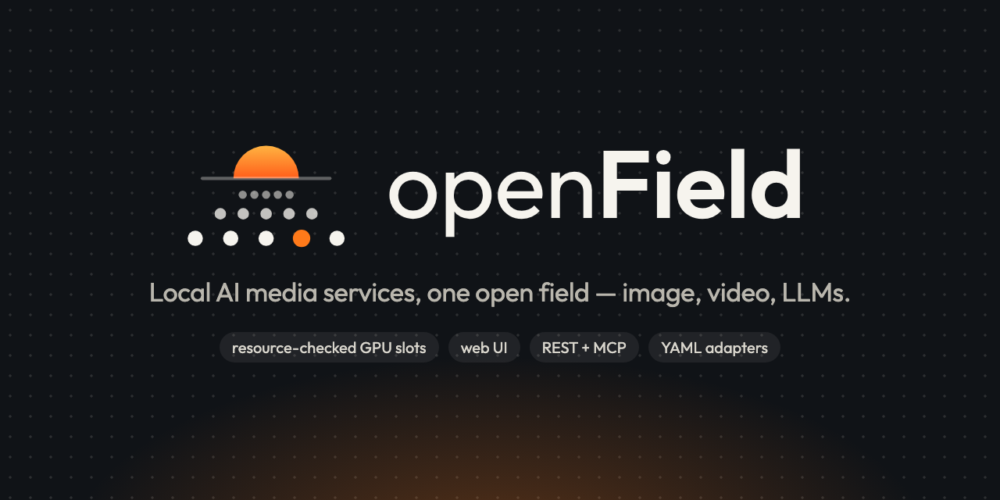

# openField — brand



## Concept

**An open field at dawn.** The mark is a sun rising over the horizon above rows of dots in perspective. The dots
are the field: the services, the jobs, the possibilities. A single dot lit in the sun's colour is the job running
now, openField's core idea: the GPU used with judgment, every job admitted only when there is a slot and the
resources for it.

- **open:** local, open, no cloud; light weight in the name.
- **Field:** the field of work; heavy weight in the name.

## Logo

| File | Use |
|---|---|
| `openfield-logo.svg` | Horizontal logo on light backgrounds |
| `openfield-logo-dark.svg` | Horizontal logo on dark backgrounds |
| `openfield-mark.svg` / `openfield-mark-dark.svg` | The mark alone (light / dark) |
| `openfield-icon.svg`, `openfield-icon-512.png` | App icon (ink rounded square) |
| `openfield-favicon.svg` | Simplified favicon, legible at 16 px |
| `social-preview.png` | Repository social preview (1280×640) |

The logo text is converted to outlines, so the files do not depend on an installed font. To rebuild everything
from the same geometry:

```sh
uv run --no-project --with uharfbuzz --with fonttools python scripts/build_brand.py
```

Rules: keep clear space around the logo equal to the sun's height; do not change the sun's colours or the lit
dot; the name is written **openField** (lower-case o, capital F).

## Colours

| Name | Light | Dark | Use |
|---|---|---|---|
| Ink | `#15181D` | `#ECEAE3` (text) | Text, mark, icon |
| Paper | `#F6F4EE` | `#101317` (background) | Background |
| Panel | `#FFFFFF` | `#171A20` | Cards |
| Sun (gradient) | `#FFB341` → `#FF5E1A` | same | Sun, primary buttons, progress |
| Lit dot | `#FF7A1A` | same | The running job, focus |
| Ember | `#C2410C` | `#FF8A3D` | Links and highlighted text (AA contrast) |
| Meadow | `#2F8F5B` | `#5BC48A` | GPU free, success |
| Error | `#C53030` | `#F07171` | Errors, cancel |

Text on the sun gradient is always **Ink** (contrast above 7:1).

## Typography

**Outfit** (SIL Open Font License, variable file 100–900, in `src/openfield/web/fonts/`): 400 for text,
500–600 for headings and buttons. Tabular figures in the UI. Code in `ui-monospace`.

## Elements

- **Field of dots:** the sign-in screen's background (a dot every 22 px) with the glow of the rising sun at the
  bottom.
- **Pulsing dot:** the GPU in use and the running job.
- **Progress bar:** the sun gradient, with a sheen that runs while the job runs.
- **Slots:** circles that light up in the sun's colour, one per parallel job.
